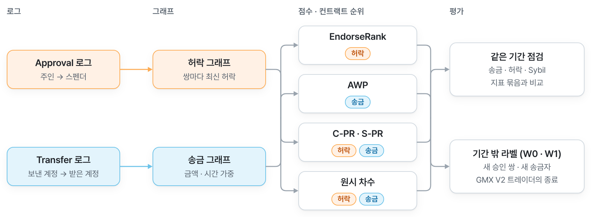

# Integrating ERC-20 Allowance Edges into PageRank for Enhanced On-Chain Wallet Reputation Scoring

Research repository of a doctoral study at the University of South Africa on ERC-20 allowance edges in PageRank-based reputation scores. The analysis plan, the W1 registration, the code, the queries and the published results are under [`experiments/`](experiments/). The English thesis and the two journal manuscripts are the submodule `dissertation/overleaf-github` ([phd-dissertation-draft-en](https://github.com/abitocodes/phd-dissertation-draft-en)). [`HISTORY.md`](HISTORY.md) explains how the commit history was copied from the authors' working repository and maps the commit identifiers that older documents record. Most documentation below is in Korean.

학위논문 작업 폴더입니다. 저자들의 작업 저장소에 있던 이 폴더를 커밋 이력과 함께 옮겼습니다(옮긴 방법과 커밋 번호의 대응은 [`HISTORY.md`](HISTORY.md)). 폴더 이름 `ERC20-Allowance-PageRank-Wallet-Reputation`은 이 제목을 줄인 것입니다(전체 제목을 쓰면 Windows 경로 길이 제한 260자를 넘음). 이 연구는 2026-10-09에 `1-Dissertation-Works/ERC20-Allowance-PageRank-Contract-Reputation/`에서 시작했고, 2026-10-11에 이 폴더로 옮겼습니다.

## 연구

Arbitrum One의 스마트 컨트랙트에 온체인 평판 점수를 매깁니다. 이 연구의 방법은 토큰 주인이 컨트랙트에 준 ERC-20 허락(allowance) 간선과 송금 간선을 한 걸음으로 함께 걷는 결합 PageRank C-PR이고, 허락 간선만 걷는 EndorseRank와 송금 간선만 걷는 AWP(Adaptive Weighted PageRank)를 기준 보행으로 두어 C-PR의 절제인 S-PR, 원시 차수와 함께 견줍니다(2026-10-22 저자 결정, [`dissertation/notes/_writing-brief.md`](dissertation/notes/_writing-brief.md)). 점수를 매기고 평가하는 대상은 스마트 컨트랙트이고, EOA(외부 소유 계정)는 허락·송금 간선의 출발점과 도착점으로만 그래프에 들어갑니다. 데이터는 Arbitrum One의 2023-10-01부터 2026-09-30까지 3년입니다.

<picture>
  <source media="(prefers-color-scheme: dark)" srcset=".github/readme/thesis-scores-dark.png">
  
</picture>

## 폴더

| 폴더 | 내용 |
|------|------|
| `proposal/` | 연구계획서. 고치지 않는 기준선이라 폴더 안에 README를 두지 않고, 아래 「연구계획서」에서 안내합니다. |
| [`dissertation/`](dissertation/) | 영문 원고(서브모듈), 발표 자료, 원고를 쓸 때 지키는 메모 |
| [`experiments/`](experiments/) | BigQuery 추출, 점수 계산, 평가 코드와 데이터 |
| [`references/`](references/) | 참고 문헌 69편의 목록과 서지 정보(원문 PDF는 저작권 때문에 두지 않음) |
| [`archive/`](archive/) | 옛 지갑 평판 연구의 자료(읽기 전용) |

## 기간

| 구간 | 날짜 | 쓰임 |
|------|------|------|
| 추출 기간 | 2023-10-01 ~ 2026-06-30 (스캔 A), 7~9월은 스캔 B | 등록 분석은 2023-10-01부터의 모든 사건으로 점수를 만듦 |
| 점수 기간(주 분석) | 동결마다 직전 12개월: T_obs·W1 2025-07-01 ~ 2026-06-30, W0 2025-04-01 ~ 2026-03-31 | 같은 기간 정렬, 벤치마크, 강건성, 두 홀드아웃 |
| 홀드아웃 W0 | 2026-03-31 동결, 4~6월 라벨 | 스펜더 홀드아웃, 규칙 A |
| 등록 재현 W1 | 2026-06-30 동결, 7~9월 라벨 | 등록 파일을 커밋한 뒤에 7~9월 로그를 추출 |

## 두 분석: 등록 분석과 수정 분석

| | 등록 분석 | 수정 분석 (논문의 주 결과) |
|---|---|---|
| 점수 기간 | 2023-10-01부터의 모든 사건 | 동결마다 직전 12개월 |
| 금액 | 원시 base unit, b = 1 | USD (DefiLlama 일별 종가), b = ln3/m (m_T = $170, m_A = $100, W0 점수 기간에서 정함) |
| 토큰 | 모든 ERC-20 | WETH, USDC, USDT0, ARB, WBTC (Chainlink low·medium 규칙을 통과하고 가격이 있는 46개 중 행 수 상위 5개) |
| 코호트 | 27,844 | 동결마다 그 12개월 안에서: T_obs 6,483, W0 6,343 (등록 코호트의 부분집합) |
| C-PR 승인 층 | 원시 합 | min(USD, $19,000) 합 |
| 고정 시점 | 계획 d060f3a, W1 등록 1747e64 (모두 결과 전) | USD 수정 1d4b9d6·d4796eb·52aa40b (2026-10-10), 12개월 점수 기간 69c7d12 (2026-10-28). 모두 등록 결과를 본 뒤 |
| 결과 | `experiments/data/3-published-results-for-thesis/` | `.../3-published-results-for-thesis/revised-usd-12m/` |
| 실행 | `CONTRACT_REP_VARIANT` 없이 | `CONTRACT_REP_VARIANT=usd12m` (`scripts/run_usd12m_pipeline.py`, `scripts/run_usd_local.ps1 -Variant usd12m`) |

분석 계획 `d060f3a`는 2026-10-09 13:41 UTC(이 연구의 첫 추출 10초 전)에, W1 등록 `1747e64`는 같은 날 16:49 UTC(7~9월 로그 추출 8초 전)에 커밋했습니다. 수정 분석은 등록 이후의 이탈(deviation)이라 그 결과를 '등록된 결과'라고 부르지 않습니다. 이유와 규칙은 `experiments/docs/revision_price_weighting.md`(금액과 토큰)와 `experiments/docs/revision_one_year_window.md`(점수 기간)에 있습니다. 원고는 12개월 점수 기간을 주 분석의 설계로 서술하고, 그 정의를 등록 결과를 본 뒤 정했다고 밝힙니다. 33개월 USD 결과(`revised-usd/`)는 기록으로만 남깁니다. 토큰 목록과 가격은 `experiments/data/0-usd-token-list-and-prices/`에 있습니다. 지도교수가 수정 분석을 주 분석으로 할지는 아직 확인하지 않았습니다.

## 결과 (수정 분석)

모든 수치와 그 출처(JSON 파일과 키)는 [`experiments/data/3-published-results-for-thesis/revised-usd-12m/results_digest.md`](experiments/data/3-published-results-for-thesis/revised-usd-12m/results_digest.md)에, 등록 분석의 수치는 그 위 폴더의 `results_digest.md`에 있습니다. 공개한 파일의 SHA-256은 같은 폴더의 `SHA256SUMS.txt`에 있습니다. 괄호는 95% 부트스트랩 구간입니다.

- 각 점수는 자기 간선으로 만든 점검과 가장 잘 맞았습니다. EndorseRank와 허락 지표 묶음의 τ_b는 0.560 [0.548, 0.571], AWP와 송금 지표 묶음은 0.736 [0.728, 0.744]입니다. 두 점수의 순서는 서로 달랐습니다(τ_b 0.199 [0.181, 0.221]).
- C-PR(λ = 0.5)은 분석 계획의 규칙 A도, W1 등록의 규칙 B도 충족하지 못했습니다(등록 분석과 같은 판정).
- 기간 밖에서는 어떤 PageRank도 같은 간선의 원시 차수를 넘지 못했습니다. 아래는 Kendall τ_b의 차이입니다. W1의 C-PR − AWP 두 칸은 W1 등록의 민감도 분석에 들어 있고, 나머지는 라벨을 본 뒤 계산한 사후 대비입니다.

| 비교 | W0 | W1 |
|---|---|---|
| AWP − 송금 입차수, 새 송금자 | −0.038 [−0.043, −0.032] | −0.041 [−0.047, −0.034] |
| EndorseRank − 승인 입차수, 새 승인 쌍 | −0.090 [−0.100, −0.079] | −0.082 [−0.090, −0.073] |
| EndorseRank(활동 재시작) − 승인 입차수, 새 승인 쌍 | −0.060 [−0.070, −0.052] | −0.046 [−0.055, −0.038] |
| C-PR − EndorseRank, 새 승인 쌍 | +0.026 [0.016, 0.037] | +0.017 [0.006, 0.029] |
| C-PR − AWP, 새 승인 쌍 | +0.133 [0.114, 0.153] | +0.159 [0.139, 0.178] |
| C-PR − AWP, 새 송금자 | −0.073 [−0.083, −0.063] | −0.075 [−0.085, −0.065] |

C-PR이 AWP보다 새 승인 쌍을 높게 매기는 것은 주로 AWP가 0점을 주는 스펜더(송금 간선이 없는 W0 스펜더의 약 6분의 1) 덕분입니다. 송금을 받은 스펜더만 보면 새 승인 쌍은 W0에서 비슷하고(+0.008 [−0.002, 0.020]) W1에서 C-PR이 조금 앞서며(+0.022 [0.011, 0.033]), 새 송금자는 두 창 모두 AWP가 앞섭니다(원고 4장 sub:cpr-contrasts, 표 cpr-contrasts). GMX V2 계약 트레이더의 청산 없는 마감 비율에서는 승인 입차수가 송금 입차수를 W1에서 앞섰습니다(P +0.141, 97.5% 구간 [0.026, 0.256], R1 성립). 등록 분석과 33개월 USD 분석에서는 R1이 성립하지 않았습니다. AWP의 가중치와 활동 재시작을 두 층에 쓴 결합 C-AWP는 라벨을 본 뒤 정한 것이라, 원고에는 6장 향후 연구에 다음 창에 등록할 보행으로 이름만 나옵니다(2026-10-22 결정, 10-27 재확인). 그 사후 결과는 [`experiments/exploratory/2026-10-22-cpr-against-awp/`](experiments/exploratory/2026-10-22-cpr-against-awp/)에 있습니다. C-AWP를 실제 금융 성과로 검증하려는 다음 단계 연구는 [`papers/survey-2024-2026-onchain-reputation/`](../../papers/survey-2024-2026-onchain-reputation/)에 있습니다.

## 연구계획서

`proposal/`은 고치지 않는 기준선입니다(`HANDOFF.md`). 폴더 안을 바꾸지 않으려고 안내를 여기에 둡니다.

| 경로 | 내용 |
|---|---|
| `proposal/proposal/` | LaTeX 정본: `01-Intro/`(제목, 초록, 목차), `02-Content/`(10개 장), `03-End/`(참고문헌, 부록), `Config/`, `Figures/`. 빌드한 `main.pdf`, 빌드 스크립트 `build.ps1`과 `build-docx.ps1` |
| `proposal/sources/` | 교수·심사위원의 의견과 서신, 제출 서류. 저자들의 비공개 저장소에 두고 이 저장소에는 없습니다. |
| `proposal/presentation/` | 연구계획서 발표 HTML 덱과 15분 발표 대본 |
| `proposal/translations/` | 영문 수정본 스냅샷과 영한 대역본(README 있음) |
| `proposal/scripts/` | DOCX 변환·병합·번역·주석 도구 |
| `proposal/archive/` | 옛 DOCX와 작업본. 저자들의 비공개 저장소에 두고 이 저장소에는 없습니다. |

상태: 심사위원 지적을 반영한 수정본을 2026-08-04에 지도교수께 보냈고, 2026-10-10에 승인 절차를 마무리해 달라고 요청했습니다. myModules의 최종 제출 칸에는 2026-06-20 판이 남아 있습니다.

교수 피드백과 연구계획서 편집은 요청을 받았을 때만 `proposal/proposal/`에서 하고, `dissertation/`에 섞지 않습니다. 빌드는 그 폴더에서 `.\build.ps1`(→ `main.pdf`), Word 판은 `.\build-docx.ps1`(→ `main.docx`)입니다.

## 지킬 것

- 분석 계획(`experiments/docs/analysis_plan.md`)과 설정(`experiments/config/contract_reputation.yaml`)은 이 연구의 첫 추출 전에 커밋했습니다. 1~6절을 고치지 않습니다. W1 등록 파일도 고치지 않습니다.
- `proposal/`과 `archive/`는 고치지 않습니다. 테스트 `experiments/tests/`는 보관 스크립트(`archive/wallet-reputation-experiments/scripts/`)를 읽기 전용 기준으로 불러오므로, 그 폴더를 옮기거나 지우지 않습니다.
- 원고 문장 규칙(`_writing-brief.md`)은 저자들의 비공개 메모에 있습니다.
- 데이터, Drive, BigQuery 비용의 규칙은 [`experiments/README.md`](experiments/README.md)의 「데이터 정책」에 있습니다.
