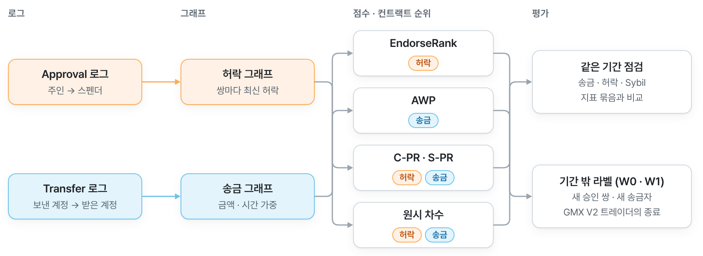

# Integrating ERC-20 Allowance Edges into PageRank for Enhanced On-Chain Wallet Reputation Scoring

Research repository of a doctoral study at the University of South Africa on ERC-20 allowance edges in PageRank-based reputation scores. The analysis plan, the W1 registration, the code, the queries and the published results are under [`experiments/`](experiments/). The English thesis and the two journal manuscripts are the submodule `dissertation/overleaf-github` ([phd-dissertation-draft-en](https://github.com/abitocodes/phd-dissertation-draft-en)). [`HISTORY.md`](HISTORY.md) explains how the commit history was copied from the authors' working repository and maps the commit identifiers that older documents record. Most documentation below is in Korean.

학위논문 작업 폴더입니다. 저자들의 작업 저장소에 있던 이 폴더를 커밋 이력과 함께 옮겼습니다(옮긴 방법과 커밋 번호의 대응은 [`HISTORY.md`](HISTORY.md)). 폴더 이름 `ERC20-Allowance-PageRank-Wallet-Reputation`은 이 제목을 줄인 것입니다(전체 제목을 쓰면 Windows 경로 길이 제한 260자를 넘음). 이 연구는 2026-10-09에 `1-Dissertation-Works/ERC20-Allowance-PageRank-Contract-Reputation/`에서 시작했고, 2026-10-11에 이 폴더로 옮겼습니다.

## 연구

Arbitrum One의 매우 많은 스마트 컨트랙트 가운데 사용자가 기대는 컨트랙트를 찾는 점수를 연구합니다(2026-11-07 저자 결정). 이 연구의 방법은 컨트랙트 사이의 ERC-20 허락(allowance) 간선과 송금 간선을 한 걸음으로 함께 걷는 결합 PageRank C-PR이고, 허락 간선만 걷는 EndorseRank와 송금 간선만 걷는 AWP(Adaptive Weighted PageRank)를 기준 보행으로 두어 C-PR의 절제인 S-PR, 원시 개수와 함께 견줍니다(2026-10-22 저자 결정).

주 분석인 계약 그래프 분석에서는 모든 그래프의 노드가 컨트랙트입니다. 사용자 계정(거래를 보낸 주소, 코드가 없는 주소, EIP-7702 계정, Safe와 ERC-4337 스마트 계정)은 어떤 그래프에도 들어가지 않고, 발견 순서 검증의 중요도와 기간 밖 라벨에만 들어갑니다. 허락은 동결 시점에 주인이 가진 잔액까지만 셉니다. 평가는 세 가지입니다.

1. 발견 순서 검증: Cho, Garcia-Molina와 Page(1998)의 크롤 순서 실험을 계약 그래프에서 되풀이해, 점수가 정한 순서로 읽어 나갈 때 사용자 계정의 수요가 큰 컨트랙트에 얼마나 빨리 닿는지 봅니다.
2. 기간 밖 예측: 동결한 점수가 그 뒤 석 달(W0, W1)의 새 승인 쌍과 새 송금자를 얼마나 맞히는지 봅니다.
3. 분석 계획의 규칙 A와, W1 등록의 규칙 B 가운데 두 기준(F1, F2)을 계약 그래프의 점수에 재분석으로 적용합니다.

DeFi 신용은 이런 점수의 나중 쓰임으로만 적고 시험하지 않습니다. 데이터는 Arbitrum One의 2023-10-01부터 2026-09-30까지 3년이고(등록 분석), 주 분석은 2025-04-01부터 2026-09-30까지의 다섯 토큰 사건을 체인 전체에서 읽습니다.

<picture>
  <source media="(prefers-color-scheme: dark)" srcset=".github/readme/thesis-scores-dark.png">
  
</picture>

## 폴더

| 폴더 | 내용 |
|------|------|
| `proposal/` | 연구계획서. 고치지 않는 기준선이라 폴더 안에 README를 두지 않고, 아래 「연구계획서」에서 안내합니다. |
| [`dissertation/`](dissertation/) | 영문 원고(서브모듈), 발표 자료, 원고를 쓸 때 지키는 메모 |
| [`experiments/`](experiments/) | BigQuery 추출, 점수 계산, 평가 코드와 데이터 |
| [`references/`](references/) | 참고 문헌 69편의 목록과 서지 정보(원문 PDF는 저작권 때문에 두지 않음) |
| [`archive/`](archive/) | 옛 지갑 평판 연구의 자료(읽기 전용) |

## 기간

| 구간 | 날짜 | 쓰임 |
|------|------|------|
| 추출 기간(등록 분석) | 2023-10-01 ~ 2026-06-30 (스캔 A), 7~9월은 스캔 B | 등록 분석은 2023-10-01부터의 모든 사건으로 점수를 만듦 |
| 주 분석의 사건 | 2025-04-01 ~ 2026-09-30, 다섯 토큰, 체인 전체 | 계정 종류 판별, 계약 그래프, 잔액, 중요도, 라벨 |
| 점수 기간(주 분석) | 동결마다 직전 12개월: T_obs·W1 2025-07-01 ~ 2026-06-30, W0 2025-04-01 ~ 2026-03-31 | 같은 기간 점검, 발견 순서 검증, 벤치마크, 민감도, 두 홀드아웃 |
| 홀드아웃 W0 | 2026-03-31 동결(t1), 4~6월 라벨 | 스펜더 홀드아웃, 규칙 A |
| 등록한 창 W1 | 2026-06-30 동결(T_obs), 7~9월 라벨 | 등록 파일을 커밋한 뒤에 7~9월 로그를 추출. 규칙 B의 두 기준 |

## 두 분석: 등록 분석과 주 분석(계약 그래프 분석)

| | 등록 분석 | 주 분석: 계약 그래프 분석 |
|---|---|---|
| 노드 | 코호트의 사건에 나오는 모든 계정 | 컨트랙트만(스마트 계정은 사용자 계정으로 보아 뺌) |
| 간선 | 코호트 컨트랙트가 한쪽 끝인 사건 | 체인 전체에서 읽은, 두 끝이 모두 컨트랙트인 사건 |
| 점수 기간 | 2023-10-01부터의 모든 사건 | 동결마다 직전 12개월 |
| 금액 | 원시 base unit, b = 1 | USD (DefiLlama 일별 종가), b = ln3/m (m_T = $160, m_A = $0.071, W0 점수 기간의 계약 그래프에서 정함) |
| 허락 | 최신 허락 그대로 | 동결 시점 주인의 잔액까지만: min(허락, 잔액). 잔액은 Transfer 로그에서 다시 만들고 `balanceOf`와 대조 |
| 토큰 | 모든 ERC-20 | WETH, USDC, USDT0, ARB, WBTC (Chainlink low·medium 규칙을 통과하고 가격이 있는 46개 중 행 수 상위 5개) |
| 코호트 | 27,844 | 동결마다 그 12개월 안에서 뽑고 사용자 계정으로 판별된 구성원을 뺌: T_obs 6,443, W0 6,292 |
| C-PR 허락 층 | 원시 합 | min(잔액 상한 뒤 USD, $16,000) 합 |
| 평가 | 같은 기간 점검, W0, W1, 규칙 A와 B | 발견 순서 검증, 같은 기간 점검, W0, W1, 규칙 A와 규칙 B의 두 기준(재분석) |
| 고정 시점 | 계획 d060f3a, W1 등록 1747e64 (모두 결과 전) | 모두 등록 결과를 본 뒤: USD 수정 1d4b9d6·d4796eb·52aa40b (2026-10-10), 12개월 점수 기간 69c7d12 (2026-10-28), 계약 그래프 명세와 발견 순서 프로토콜 d39775c (2026-11-07), 스마트 계정 규칙의 확장 caf97c3과 프로토콜 확정 8645bca (2026-11-09) |
| 결과 | `experiments/data/3-published-results-for-thesis/` | `.../3-published-results-for-thesis/revised-contract-12m/` |
| 실행 | `CONTRACT_REP_VARIANT` 없이 | `CONTRACT_REP_VARIANT=contract12m` (`scripts/run_contract12m_pipeline.py`, 그다음 평가 스크립트들; [`experiments/README.md`](experiments/README.md)) |

분석 계획 `d060f3a`는 2026-10-09 13:41 UTC(이 연구의 첫 추출 10초 전)에, W1 등록 `1747e64`는 같은 날 16:49 UTC(7~9월 로그 추출 8초 전)에 커밋했습니다. 주 분석은 등록 이후의 이탈(deviation)이라 그 결과를 '등록된 결과'라고 부르지 않습니다. 이유와 규칙은 `experiments/docs/`의 네 문서에 있습니다: `revision_price_weighting.md`(금액과 토큰), `revision_one_year_window.md`(점수 기간), `revision_contract_graph.md`(계약만의 그래프, 계정 종류, 잔액 상한, 상수), `discovery_protocol.md`(발견 순서 검증). 원고는 주 분석을 하나의 설계로 서술하고, 그 정의를 등록 결과를 본 뒤 정했다고 밝힙니다. 사용자 계정이 그래프에 들어 있던 12개월 USD 결과(`revised-usd-12m/`)와 33개월 USD 결과(`revised-usd/`)는 기록으로만 남기고 원고에 넣지 않습니다. 토큰 목록과 가격은 `experiments/data/0-usd-token-list-and-prices/`에 있습니다. 지도교수가 이 분석을 주 분석으로 할지는 아직 확인하지 않았습니다.

## 결과 (주 분석)

모든 수치와 그 출처(JSON 파일과 키)는 [`experiments/data/3-published-results-for-thesis/revised-contract-12m/results_digest.md`](experiments/data/3-published-results-for-thesis/revised-contract-12m/results_digest.md)에, 등록 분석의 수치는 그 위 폴더의 `results_digest.md`에 있습니다. 공개한 파일의 SHA-256은 같은 폴더의 `SHA256SUMS.txt`에 있습니다. 괄호는 95% 부트스트랩 구간입니다. 아래 결과는 모두 등록 결과를 본 뒤 정한 분석의 것이라 '등록된 결과'가 아닙니다.

- **자료.** 다섯 토큰의 사건 1,240,275,042행에서 주소를 판별해 사용자 계정 21,877,279개와 컨트랙트 1,829,719개를 얻었습니다. T_obs의 계약 그래프에는 잔액 상한 뒤의 허락 쌍 115,006개(그 가운데 98,073개를 한 주인 컨트랙트가 가짐)와 송금 쌍 2,580,709개가 있습니다. 컨트랙트 사이의 허락 층은 얇습니다.
- **발견 순서 검증**(판정은 T_obs, 방문이 들어오는 간선과 나가는 간선을 모두 드러내는 방식). 읽은 부분 위의 C-PR로 순서를 정한 크롤은 너비 우선 크롤보다 중요한 컨트랙트에 먼저 닿았지만(AUC 차이: 사용자 계정의 송금 유입 +0.0520 [+0.0485, +0.0558], 사용자가 허락한 금액 +0.0061 [+0.0014, +0.0111]), 컨트랙트 백링크 수로 순서를 정한 크롤보다 먼저 닿지는 못했습니다(−0.0051 [−0.0087, −0.0010], −0.0571 [−0.0621, −0.0519]). 프로토콜의 판정은 V2입니다. 크롤 가운데 AUC가 가장 높은 것은 송금 층의 AWP였습니다. 나가는 간선만 드러내는 방식에서는 네 대비가 두 동결 모두 0보다 위였지만, 이 방식은 판정에 쓰이지 않는 민감도입니다.
- **같은 기간 점검.** 각 점수는 자기 간선으로 만든 점검과 가장 잘 맞았습니다. EndorseRank와 허락 지표 묶음의 τ_b는 0.839 [0.828, 0.849], AWP와 송금 지표 묶음은 0.755 [0.748, 0.762]입니다. 두 점수의 순서는 서로 달랐습니다(τ_b 0.275 [0.258, 0.294]).
- **규칙.** C-PR(λ = 0.5)은 분석 계획의 규칙 A를 충족하지 못했습니다. W1 등록의 규칙 B에서 적용한 두 기준 가운데 F1은 섰고(+0.074 [0.060, 0.087]) F2는 서지 않았습니다(−0.016 [−0.022, −0.012], 여유 −0.01). 규칙 B는 충족되지 않았습니다. 등록 분석에서도 읽기가 같았습니다.
- **기간 밖 예측.** 아래는 Kendall τ_b의 차이입니다. W1의 C-PR − AWP 두 칸은 W1 등록의 민감도 분석에 들어 있고, 나머지는 라벨을 본 뒤 계산한 사후 대비입니다.

| 비교 | W0 | W1 |
|---|---|---|
| EndorseRank − 승인 입차수, 새 승인 쌍 | −0.036 [−0.046, −0.027] | −0.034 [−0.043, −0.025] |
| EndorseRank(활동 재시작) − 승인 입차수, 새 승인 쌍 | −0.041 [−0.053, −0.029] | −0.033 [−0.044, −0.022] |
| AWP − 송금 입차수, 새 송금자 | +0.012 [0.003, 0.023] | +0.011 [0.001, 0.022] |
| C-PR − 합집합 입차수, 새 승인 쌍 | +0.016 [0.007, 0.024] | +0.011 [0.003, 0.019] |
| C-PR − 합집합 입차수, 새 송금자 | −0.053 [−0.061, −0.043] | −0.056 [−0.065, −0.047] |
| C-PR − EndorseRank, 새 승인 쌍 | −0.026 [−0.046, −0.004] | −0.043 [−0.062, −0.025] |
| C-PR − AWP, 새 승인 쌍 | +0.044 [0.029, 0.058] | +0.040 [0.026, 0.055] |
| C-PR − AWP, 새 송금자 | −0.077 [−0.087, −0.068] | −0.077 [−0.086, −0.069] |

AWP는 스펜더 코호트 전체에서는 송금 입차수보다 조금 위였지만, 동결 전에 다른 컨트랙트의 송금을 받은 W0 스펜더 4,569개만 보면 아래였습니다(−0.035 [−0.049, −0.022]). 기간 밖 수치를 읽을 때 두 가지를 함께 봅니다. 라벨은 주로 사용자 계정을 세는데(W0 새 승인 쌍의 90.4%) 어떤 점수도 사용자 계정의 간선을 읽지 않고, 각 스펜더 코호트의 약 27%는 합집합 그래프 밖에 있어 모든 점수에서 0점입니다. AWP의 가중치와 활동 재시작을 두 층에 쓴 결합 C-AWP는 라벨을 본 뒤 정한 것이라, 원고에는 6장 향후 연구에 다음 창에 등록할 보행으로 이름만 나옵니다(2026-10-22 결정, 10-27 재확인). 그 사후 결과는 [`experiments/exploratory/2026-10-22-cpr-against-awp/`](experiments/exploratory/2026-10-22-cpr-against-awp/)에 있습니다(사용자 계정이 그래프에 들어 있던 분석의 것). 이런 점수를 실제 금융 성과로 검증하는 일은 다음 단계 연구이고, 그 문헌 조사는 저자들의 비공개 저장소에 있습니다.

## 연구계획서

`proposal/`은 고치지 않는 기준선입니다(`HANDOFF.md`). 폴더 안을 바꾸지 않으려고 안내를 여기에 둡니다.

| 경로 | 내용 |
|---|---|
| `proposal/proposal/` | LaTeX 정본: `01-Intro/`(제목, 초록, 목차), `02-Content/`(10개 장), `03-End/`(참고문헌, 부록), `Config/`, `Figures/`. 빌드한 `main.pdf`, 빌드 스크립트 `build.ps1`과 `build-docx.ps1` |
| `proposal/sources/` | 교수·심사위원의 의견과 서신, 제출 서류. 저자들의 비공개 저장소에 두고 이 저장소에는 없습니다. |
| `proposal/presentation/` | 연구계획서 발표 HTML 덱과 15분 발표 대본 |
| `proposal/translations/` | 영문 수정본 스냅샷과 영한 대역본(README 있음) |
| `proposal/scripts/` | DOCX 변환·병합·번역·주석 도구 |
| `proposal/archive/` | 옛 DOCX와 작업본. 저자들의 비공개 저장소에 두고 이 저장소에는 없습니다. |

상태: 심사위원 지적을 반영한 수정본을 2026-08-04에 지도교수께 보냈고, 2026-10-10에 승인 절차를 마무리해 달라고 요청했습니다. myModules의 최종 제출 칸에는 2026-06-20 판이 남아 있습니다.

교수 피드백과 연구계획서 편집은 요청을 받았을 때만 `proposal/proposal/`에서 하고, `dissertation/`에 섞지 않습니다. 빌드는 그 폴더에서 `.\build.ps1`(→ `main.pdf`), Word 판은 `.\build-docx.ps1`(→ `main.docx`)입니다.

## 지킬 것

- 분석 계획(`experiments/docs/analysis_plan.md`)과 설정(`experiments/config/contract_reputation.yaml`)은 이 연구의 첫 추출 전에 커밋했습니다. 1~6절을 고치지 않습니다. W1 등록 파일도 고치지 않습니다.
- 주 분석의 명세와 발견 순서 프로토콜(`experiments/docs/revision_contract_graph.md`, `discovery_protocol.md`), 그리고 테스트(`experiments/tests/test_contract12m.py`)가 해시로 지키는 코드와 SQL은 평가를 돌리기 전에 커밋했습니다. 고치지 않습니다.
- 주 분석의 결과를 '등록된 결과'라고 부르지 않습니다. 규칙 B는 적용한 두 기준(F1, F2)으로만 말합니다.
- 원고(학위논문 영어·한국어, 투고 논문 A·B와 그 보충 자료·커버 레터, 해설판)는 연구 내용을 씁니다. 연구 과정의 정당성을 변호하지 않고, 제목에도 연구 과정을 내세우는 말을 넣지 않습니다. 커밋 해시는 원고마다 한 번만, 끝부분의 데이터 위치 안내에서 씁니다. 우리가 커밋하고 데이터를 추출하고 계산을 돌린 날짜와 시각은 쓰지 않고, 필요할 때만 순서를 씁니다. 데이터가 어느 기간의 것인지는 그대로 씁니다. 이 README와 메모는 원고가 아니므로 기록을 찾아가는 식별자와 시각을 둡니다.
- `proposal/`과 `archive/`는 고치지 않습니다. 테스트 `experiments/tests/`는 보관 스크립트(`archive/wallet-reputation-experiments/scripts/`)를 읽기 전용 기준으로 불러오므로, 그 폴더를 옮기거나 지우지 않습니다.
- 원고 문장 규칙(`_writing-brief.md`)은 저자들의 비공개 메모에 있습니다.
- 데이터, Drive, BigQuery 비용의 규칙은 [`experiments/README.md`](experiments/README.md)의 「데이터 정책」에 있습니다.
